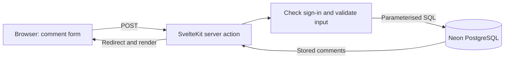

# Presentation outline — 2 + 6 + 2 minutes

This follows page 4 of the original assignment. Teaching topic: **how a comment travels from the browser into a PostgreSQL database and back**. It is concrete, permitted by the brief and easy to connect to the PD persistence requirement.

This is an outline and rehearsal guide. Create/export the actual concise slide deck, place it in `documents/`, and submit it in Canvas as well as the repository.

## Prepare before presenting

- Run the final build/preview and keep it running. Use localhost, not a plain-HTTP LAN address.
- Confirm your administrator sign-in works. Keep passwords and keys hidden; never open `.env` on the projector.
- Prepare a small project form using clearly labelled demo content, a short comment and a HEX such as `#DEC1DA`.
- Confirm one real AI summary works before class. If it does not, state the limitation honestly; never present a mocked response as a real service response.
- Use a project with a saved summary as a backup for an internet/model outage. Keep a screenshot without private information.
- Open `src/lib/server/comments.js` and the relevant `addComment` action in `src/routes/studio/+page.server.js`. Show small excerpts, not full files.
- Prepare a plain-text comment such as `This comment stays after refreshing.` Do not use private client information.

## 0:00–2:00 — demonstrate the website

| Time | Show | Say, in your own words |
| --- | --- | --- |
| 0:00–0:15 | Home and Work | “This portfolio presents my design work to potential clients and collaborators. My teacher approved projects instead of blog posts.” |
| 0:15–0:30 | Filter Work, open a project, return | “The category filter is JavaScript in the browser. Project content comes from Neon.” |
| 0:30–0:45 | Type `/studio`, sign in | “Course tools are unlinked and protected on the server.” |
| 0:45–1:10 | Generate a draft, review it and save the prepared project | “Generate AI Summary asks OpenRouter for a draft. I can edit it before Save project stores the approved text in Neon.” Allow time for the request. |
| 1:10–1:30 | Add a comment, refresh | “This is saved in PostgreSQL, so refreshing does not lose it.” |
| 1:30–1:45 | Show a Fontsource-backed daily font | “The font tool automatically requests metadata from Fontsource and uses the returned family name. This is separate from the AI feature.” |
| 1:45–2:00 | Show stored summary and sign out | “The summary is labelled AI-generated. Refresh reads the saved result. Signing out removes access to the tools.” |

If typing or network calls take too long, show already prepared results and explain what was tested. Do not claim a failed request succeeded. Practise with a timer.

## 2:00–8:00 — teach one aspect, not the entire codebase

### Slide 1 — concept: a browser variable versus a database (2:00–3:00)

On the slide: two boxes, “temporary browser state” and “stored database row”.

Say: “A variable can hold a comment while the page is open. PostgreSQL stores it outside the browser, so another request can retrieve it later. Neon hosts my PostgreSQL database. A row is one saved comment; columns hold its name, message, project and date.”

Learning goal: “By the end, you can follow one form submission and explain why the comment survives refresh.”

### Slide 2 — data flow (3:00–4:15)



Define POST as a request that submits information, validation as checking that the entered values are allowed, and SQL as the language used to read/write database rows. Explain that the browser never receives the connection string.

### Slide 3 — a small example from my code (4:15–6:15)

Use the actual insert from `src/lib/server/comments.js`, shortened only for slide readability:

```js
requireUser(locals);
const sql = database();
const saved = await sql`
  INSERT INTO comments (project_id, display_name, message)
  SELECT id, ${values.name}, ${values.message}
  FROM projects WHERE slug = ${values.project}
  RETURNING id`;
```

Explain each step:

1. `requireUser` refuses a guest before writing.
2. `database()` uses private server configuration.
3. The values go into placeholders; they are not pasted into the SQL command. This prevents SQL injection.
4. The project lookup ties the comment to a real project.
5. `RETURNING id` tells us a row was saved.

Then show the retrieval idea from the same file: select comments for the chosen project and order by date/id descending. Explain “newest first”. The page is redirected after success, so refresh reads the database rather than posting again.

Show the real form, save a short comment and refresh. Point out the server validation and escaped plain-text rendering. If asked to change a limit, explain that the server check and matching form attribute must agree; do not casually increase a database constraint during the demo.

### Slide 4 — implementation process and responsible AI use (6:15–7:30)

Keep the slide to three short points: **small stages → inspect code → test outcomes**.

Explain what actually happened:

- The portfolio uses the same public content/navigation requirement as posts, with course-only tools isolated in Studio.
- AI helped break the work into stages and review/code small pieces. I still had to inspect the files and check results; asking AI for code does not prove it works.
- We tested logged-out writes, invalid input, stored data after refresh, escaped HTML, unique slugs and failed API requests. Real service tests were distinguished from mocks.
- One debugging example is responsive typography: artboard-scaled `rem` values became too small around 1001px, so computed browser sizes were checked and the transition was adjusted.

Mention the references you actually used: SvelteKit form actions, Neon SvelteKit documentation, Fontsource API docs and OpenRouter API docs. Link them in the final deck's references/notes.

### Slide 5 — recap (7:30–8:00)

Three short bullets:

- The browser submits; the server checks; the database stores.
- Private credentials stay on the server.
- Testing proves behaviour; a saved row survives refresh.

Invite questions and stop teaching at minute eight.

## 8:00–10:00 — Q&A preparation

| Likely question | Beginner-friendly answer |
| --- | --- |
| Why not save comments only in a JavaScript array? | An array in the page is temporary. The database keeps records independently of that page. |
| Why does hiding Studio not secure it? | Someone can send a request directly. Every protected action checks sign-in on the server. |
| What is in the session cookie? | A random token, not my password. The database stores a hash and an expiry. |
| What prevents SQL injection? | Parameterised queries keep entered values separate from SQL commands. |
| What if someone enters HTML? | We show escaped plain text; it does not run as HTML/JavaScript. |
| What if an API fails? | The user sees an honest error. AI generation failure keeps my form and previous draft; I can still save without a summary. |
| Which API is AI? | OpenRouter generates text. Fontsource returns font metadata; it is not the AI feature. |
| How did you choose the model? | A short summary needs a small output budget. I configured a low-cost text model and checked the real account/model before the live test. Do not invent a price or claim a model test that did not run. |
| Can you explain `$state` and `$derived`? | State stores the selected category; a derived value calculates which projects match it. |
| What did AI do and what did you verify? | Explain your real prompts, code review and the test evidence in VALIDATION.md. |

## Final slide-deck checklist

- Put only short bullets, the diagram and one small code example on slides.
- Put fuller explanations in your speaker notes, not dense slide text.
- No credentials, private browser tabs, unapproved artwork or licensed font files in the submitted deck.
- Include the deck in the public repository and upload it in Canvas.
- Rehearse the complete ten minutes twice, including one API-failure fallback.
